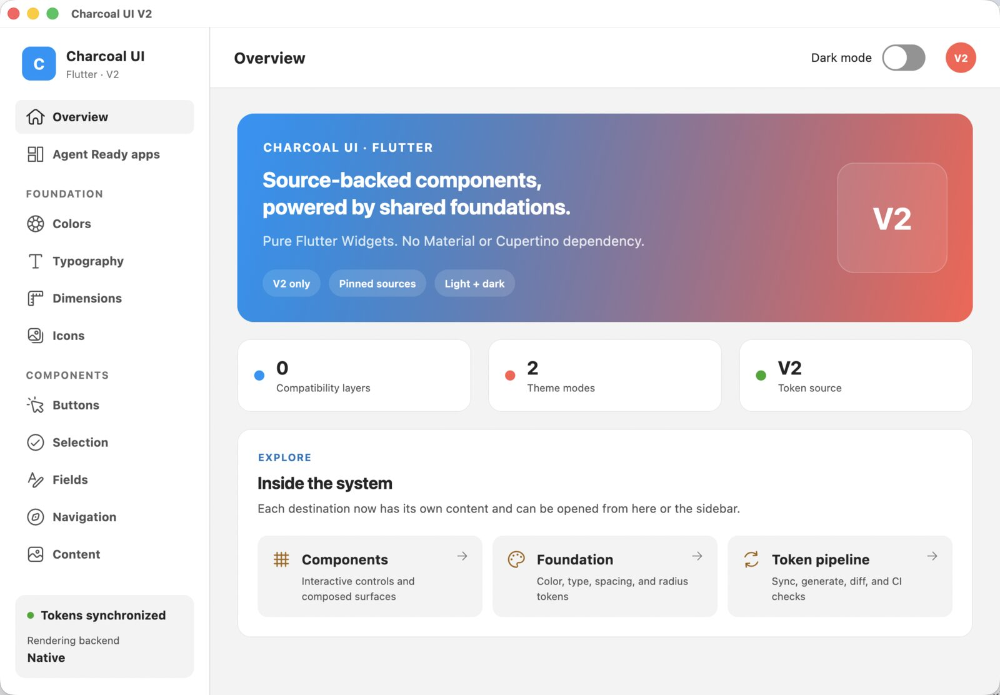

# Charcoal UI for Flutter

A Charcoal V2 UI library for Flutter, built on Material. The library owns every colour, size, type
style and component geometry; applications compose Charcoal components and never construct visual
values. A generated theme contract (`charcoal_theme`) turns the pinned Charcoal V2 tokens into
packs, a builder turns a pack into a Material `ThemeData` plus a `ThemeExtension`, and
source-backed components in `charcoal_ui` read only from that theme. Light and dark themes,
accessibility behavior and reproducible drift checks come with it.

**Agent Ready by design.** Charcoal ships a version-matched page-design Skill, generated API and
theme-role Catalog, CLI/MCP discovery, Widget Preview workflow, and app-wide review gates so coding
agents can discover, compose, and verify the exact installed UI version instead of guessing.
[Install the required agent integration](#required-install-the-agent-integration) before using an
agent to design or implement product UI.



This project is V2-only. It intentionally contains no Charcoal V1 aliases or compatibility API.

Explore the [Charcoal UI V2 Showcase](https://kevinzhow.github.io/charcoal-flutter/) in a browser.

## Packages

- `packages/charcoal_tokens`: generated color, dimension, and typography foundations.
- `packages/charcoal_theme`: the theme contract (colour roles, scales, per-family metrics), the
  generated light and dark packs, `buildCharcoalThemeData`, and the `CharcoalTheme`
  `ThemeExtension`. It depends only on Flutter and `charcoal_tokens`.
- `packages/charcoal_icons`: the generated Charcoal Icons V2 SVG catalog and Flutter widget.
- `packages/charcoal_ui`: Material-based components, `CharcoalApp`, and interaction primitives.
  `package:charcoal_ui/charcoal_ui.dart` re-exports `charcoal_theme`;
  `package:charcoal_ui/admin.dart` adds admin-console pieces; `package:charcoal_ui/testing.dart`
  provides the extreme-theme pack and scene type for guard tests.
- `packages/charcoal_catalog`: versioned component API, usage guidance, and executable examples.
- `packages/charcoal_cli`: deterministic discovery, diagnostics, and agent-instruction setup.
- `packages/charcoal_mcp`: read-only MCP adapter over the same component and theme-role Catalog.
- `example`: the exhaustive Showcase used for visual development and regression checks.
- `agent`: versioned agent-readiness benchmark prompts and scoring contract.
- `tool/tokens.dart`: pinned token sync, validation, generation (tokens and theme packs), semantic
  diff, and drift checking.
- `tool/icons.dart`: pinned icon sync, validation, generation, and drift checking.
- `tool/migrate_api.dart`: applies the recorded renames in `tool/migration/renames` to a source tree.
- `tool/visual_parity.dart` and `tool/visual`: page capture and pixel-parity tooling for the Showcase.
- `tokens/upstream`: the original V2 token JSON pinned to an exact upstream commit.
- `tokens/theme/charcoal.pack.json`: the one hand-edited mapping from theme roles to tokens.

Public components, by family (the Catalog is the authoritative list):

- App and navigation: `CharcoalApp`, `CharcoalPageRoute`, `CharcoalScaffold`, `CharcoalNavigationBar`,
  `CharcoalTabBar`, `CharcoalNavigationItem`, `CharcoalPagination`, `CharcoalCarousel`
- Actions and selection: `CharcoalButton`, `CharcoalLinkButton`, `CharcoalSwitchingButton`,
  `CharcoalIconButton`, `CharcoalCheckbox`, `CharcoalRadio`, `CharcoalSwitch`, `CharcoalSlider`,
  `CharcoalMultiSelect`, `CharcoalSegmentedControl`, `CharcoalTagItem`
- Fields and forms: `CharcoalTextField`, `CharcoalTextArea`, `CharcoalDropdown`,
  `CharcoalSearchField`, `CharcoalDateTimeField`, `CharcoalSwitchField`, `CharcoalFormSection`,
  `CharcoalFormField`, `CharcoalFieldLabel`, `CharcoalHintText`
- Overlays and feedback: modal, dialog, confirm, form, code and choice dialogs, toast, snackbar,
  tooltip, balloon, `CharcoalBanner`, empty, loading and error states, `CharcoalLoadingSpinner`
- Layout and content: `CharcoalCard`, `CharcoalList`, `CharcoalListRow`, `CharcoalSectionHeader`,
  `CharcoalAvatar`, `CharcoalBadge`, `CharcoalChip`, `CharcoalStatusDot`, `CharcoalText`,
  `CharcoalIconView`, `CharcoalCodeBlock`, and the spacing helpers `CharcoalGap`, `CharcoalInset`,
  `CharcoalPadding`, `CharcoalWrap`
- Admin console (`admin.dart`): `CharcoalAdminShell`, `CharcoalSidebar`, `CharcoalPage`,
  `CharcoalStatCard`, `CharcoalMeter`, `CharcoalInfoRows`, `CharcoalBatchBar`
- Supporting building blocks, public but not for application code: `CharcoalEditableText`,
  `CharcoalFieldRing`, `CharcoalSelectionBox`, `CharcoalSelectionToolbar`,
  `CharcoalOverlayAnchorTracker`, `CharcoalTextDefaults`. The Catalog lists them under the
  `Supporting` category so exact signatures stay discoverable for library authors.

The API follows Flutter conventions instead of reproducing another platform's view hierarchy.
Icon-bearing controls accept regular widgets; applications can use `charcoal_icons` or inject
product-specific artwork without coupling the two packages.

`charcoal_ui` does not bundle font files. Apple native targets map the default typography to their
system text and display families; Web and other native targets defer to Flutter's renderer default.
A brand or Web font is a property of the pack's typography (`CharcoalTypeScale.sansFamily`), changed
in the library or a theme package, not in application pages. The Showcase demonstrates that with a
self-hosted Google Fonts Noto Sans WOFF2 asset on Web.

## Architecture

```text
tokens/upstream/*.json   (pinned Charcoal V2 tokens)
        │  tool/tokens.dart generate
        ▼
charcoal_tokens          generated colour / dimension / typography foundations
        │
        │   tokens/theme/charcoal.pack.json   role → token reference (+ a few product literals)
        ▼
charcoal_theme           contract (CharcoalColorRoles, scales, per-family metrics)
                         generated packs  charcoalLightPack / charcoalDarkPack
                         buildCharcoalThemeData(pack) → Material ThemeData
                         CharcoalTheme extends ThemeExtension (what Material has no slot for)
        │
        ▼
charcoal_ui              Material-based components; every value read via CharcoalTheme.of(context)
        │                CharcoalApp = MaterialApp + light/dark packs + text defaults + page route
        ▼
application              composes components, supplies strings, data and logic
```

- **Theme contract.** `charcoal_theme` fixes the names of colour roles, spacing, radius, border,
  size, motion, elevation and type scales, and the geometry of each component family. Names are
  append-only. See [Theme contract](docs/theme-contract.md).
- **Generated packs.** `tokens/theme/charcoal.pack.json` maps each role to an upstream token; the
  same `tool/tokens.dart generate` transaction that writes the token sources writes
  `charcoal_pack.g.dart`, and `check` verifies byte-for-byte reproducibility. The only hand-written
  colours are the explicitly listed product literals (status tints, barrier, shadow).
- **Material `ThemeData` plus `ThemeExtension`.** `buildCharcoalThemeData` fills every Material
  slot Charcoal needs (colour scheme, buttons, inputs, dialogs, menus, scrollbars, tooltips,
  transitions) from the pack. Everything Material has no slot for (status tones, sizes, type
  roles, per-family metrics) lives on the `CharcoalTheme` extension.
- **Components on Material.** The application root is Material: `CharcoalApp` wraps `MaterialApp`
  with the pack-built `ThemeData`, so Navigator, Router, Overlay, localization, text input and
  platform plumbing are Flutter's own. Components wrap a Material widget only where Material
  supplies the behaviour (dialog routes and surface, the date and time pickers, `Slider`,
  selectable code text); the other components draw their visual layer on Flutter's widgets layer
  with the audited Charcoal geometry (switch track, text-field padding and external focus ring, tab
  bar, popovers) because Material's default look does not match it. Either way a component takes
  every value from `CharcoalTheme`, and an architecture test lists the only files that may import
  Material. Component measurements come from typed metrics in the theme contract, not from literals
  in widget code.
- **`admin.dart`.** Admin-console pieces (sidebar shell, page frame, stat card, meter, info rows,
  batch bar) are a second entry point of `charcoal_ui` so apps that do not build a console do not
  carry them in their import surface.
- **Guards.** The library enforces its own rules; see [Guards](#guards).

Component behavior is audited against two pinned sources:

1. A public SwiftUI implementation is the primary reference when one exists:
   [`pixiv/charcoal-ios@8d96f2c`](https://github.com/pixiv/charcoal-ios/tree/8d96f2cef5be9e7983898e13cf45e0222f1aadda/Sources/CharcoalSwiftUI/Components).
2. Otherwise the corresponding Charcoal implementation is used:
   [`pixiv/charcoal@08995fa`](https://github.com/pixiv/charcoal/tree/08995fa5191fa918fc5afd2c5da08490ae307da7/packages/react/src/components).
3. Flutter adds keyboard, pointer, semantics, text-scaling, reduced-motion, and viewport adaptations.

Source provenance is an implementation concern. Public component names remain platform-neutral so
components can mature without API renaming.

See [Component source contracts](docs/component-sources.md) for the complete source matrix and
verified measurements.

## Composition versus styling

The one rule for application code: **visual values come from the library; composition, product
logic, strings and data are the application's own.** Colour, type, size, radius, border, shadow and
spacing are never written in a page. Meaning is expressed with `CharcoalTone`, `CharcoalTextTone`,
`CharcoalIconTone`, `CharcoalTextRole` and `CharcoalSpace`, and surfaces come from components. When
a visual value or a component is missing, it is added to the library (and its theme contract), not
patched locally.

The consumer rules R1 to R9 make this checkable (they are also written into the managed agent
instruction block): UI imports only `charcoal_ui`, `charcoal_icons` and `flutter/widgets.dart` /
`services.dart`; no `ThemeData`, `TextStyle`, `Color`, `BoxDecoration`, numeric size or raw
Material/Cupertino control; `charcoal_ui` pinned by tag or commit; no escape-hatch pragma. The rule
set, its fixtures and the library-side rules are documented in [Guards](docs/guards.md).

## Usage

```dart
import 'package:charcoal_ui/charcoal_ui.dart';
import 'package:flutter/widgets.dart';

void main() {
  runApp(
    CharcoalApp(
      home: Center(
        child: CharcoalButton(
          variant: CharcoalButtonVariant.primary,
          onPressed: () {},
          child: const Text('Create'),
        ),
      ),
    ),
  );
}
```

Use the router constructor when navigation owns URL or deep-link state. The Navigator and Router
constructors share the same Charcoal theme, localization, scrolling, shortcut, Hero, and restoration
infrastructure:

```dart
Widget buildApplication(
  RouterConfig<Object> routerConfig,
  Iterable<LocalizationsDelegate<dynamic>> localizationsDelegates,
) => CharcoalApp.router(
  routerConfig: routerConfig,
  localizationsDelegates: localizationsDelegates,
  supportedLocales: const <Locale>[Locale('en'), Locale('ja')],
  restorationScopeId: 'charcoal-app',
);
```

Compose pages from components, spacing steps, text roles and tones. Nothing below names a colour,
size or text style:

```dart
Column(
  crossAxisAlignment: CrossAxisAlignment.stretch,
  children: <Widget>[
    const CharcoalSectionHeader('Workspace', caption: 'People who can open this project'),
    const CharcoalGap(CharcoalSpace.md),
    CharcoalCard(
      padding: const CharcoalInset.all(CharcoalSpace.lg),
      child: const CharcoalText(
        '3 members',
        role: CharcoalTextRole.caption,
        tone: CharcoalTextTone.secondary,
      ),
    ),
  ],
);
```

Import the icon package independently when composing icon-bearing controls:

```dart
import 'package:charcoal_icons/charcoal_icons.dart';

CharcoalIconButton(
  icon: const CharcoalIcon(CharcoalIcons.add),
  onPressed: () {},
  semanticLabel: 'Create',
);
```

### Custom packs

A different look is a different pack, built in the library or a theme package with the generated
foundations, never in application pages. A pack is plain data; `copyWith` on the pack and its role
groups produces a variant, and `CharcoalApp(lightPack:, darkPack:)` installs it:

```dart
final brand = charcoalLightPack.copyWith(
  colors: charcoalLightPack.colors.copyWith(primary: brandPrimary),
  radius: charcoalLightPack.radius.copyWith(md: 12),
);

CharcoalApp(lightPack: brand, home: const MyScreen());
```

Every component reads the pack through `CharcoalTheme.of(context)`, so a changed role propagates
everywhere it is used. The extreme-theme test (below) proves that no component keeps a value of
its own.

## Guards

Two rule sets keep the boundary honest. Both are plain Dart tests with fixtures, so they run in
`flutter test` and in CI.

- **Library source guard** (`packages/charcoal_ui/test/source_guard_test.dart`). Scans all of
  `packages/charcoal_ui/lib/src` with no exclusions: no colour, size, duration or text-style
  literal, no `Theme.of`, `ColorScheme` or `TextTheme` read (components use
  `CharcoalTheme.of(context)`), no Cupertino import, no unnamed ratio, and the allow pragma is
  never honoured. Literals may live only in `packages/charcoal_theme/lib/src/{contract,packs}` and
  `packages/charcoal_tokens`. The workspace-level `test/architecture_test.dart` restricts which files may import Material.
- **Extreme-theme test** (`packages/charcoal_ui/test/extreme_theme_test.dart`). Mounts every
  registered component scene under `extremePack` (mutually unrelated saturated colours and unusual
  sizes, radii, borders and type sizes) in light and dark, and fails when a widget carries a colour
  outside the pack, when a flat colour covering at least 0.05% of the screen is neither a pack
  colour nor a blend of two, or when geometry and type do not follow the pack. The artwork
  allow-list is empty.
- **Layout audit and behavior tests.** `layout_audit_test.dart` checks compact and standard
  constraints for overflow and fallback fonts; each family has behavior tests for atomic
  selection, press lifecycle, geometry stability, text scaling, semantics and focus.
- **Consumer rules R1 to R9** are versioned in the same test support and exercised against
  fixtures; an application adopts them as its own source guard.
- **Pack mapping.** `packages/charcoal_theme/test/pack_mapping_test.dart` and
  `pack_reproducible_test.dart` prove every contract role is mapped and the generated pack matches
  a fresh generation.

New scenes for the extreme-theme test are registered in `packages/charcoal_ui/test/support/scenes.dart`.

## Agent Ready

### Required: install the agent integration
### Required: install the agent integration

Agent Ready starts by installing the version-matched `charcoal-page-design` Skill and managed
instructions into the consuming project. This step is required: the CLI and MCP tools below can
expose data, but they do not install the design workflow into a coding agent.

From a Flutter project that declares the matching `charcoal_cli` as a dev dependency, run:

```bash
dart run charcoal_cli:charcoal agent install --agent auto
dart run charcoal_cli:charcoal doctor
```

Project scope is the default. `--agent auto` installs into the detected agent, `--agent all`
targets Codex, Claude, and Cursor together, and `--scope user` installs a personal copy instead.
The installer owns only the versioned Skill directory and managed instruction block; unrelated
project instructions are preserved.

After upgrading Charcoal UI and `charcoal_cli`, synchronize the installed integration and verify
that its Skill, Catalog, package version, and instructions still match:

```bash
dart run charcoal_cli:charcoal agent sync --agent auto
dart run charcoal_cli:charcoal doctor
```

`init` remains available for instruction-only bootstrap, but it does not install the Skill and is
not a substitute for `agent install`.

### Supporting CLI and MCP tooling

The installed Skill is the normative design and review workflow. The CLI and MCP server are
supporting interfaces that let agents and humans discover exact APIs and theme roles,
persist design decisions, and run repeatable verification against the installed package version.

The Catalog is generated from the real exported Dart API (`charcoal_ui.dart` and `admin.dart`), the
theme contract, and generated token sources. Every public component is curated: constructor data
and source documentation plus use/avoid guidance, accessibility and responsive rules, theme roles,
related components, and (except for the supporting building blocks) source copied from a compiling
example. Tokens are labeled `semantic` when the theme contract gives them a role (the accessor
library code reads, such as `CharcoalTheme.of(context).space.md`, and the route an application
takes, such as `CharcoalGap(CharcoalSpace.md)`) and `primitive` for palette values and upstream
tokens no role references; light/dark values are included. Coverage is reported explicitly so tools
never mistake partial guidance for a complete contract.

```bash
# Find a component or reviewed composition from product intent.
dart run charcoal_cli:charcoal search "single choice"
dart run charcoal_cli:charcoal pattern "searchable collection"

# Read the design rules, exact component API, or the theme role for a meaning.
dart run charcoal_cli:charcoal design-rules --json
dart run charcoal_cli:charcoal component CharcoalSegmentedControl
dart run charcoal_cli:charcoal token "layout spacing" --kind dimension

# Use stable JSON envelopes for automation.
dart run charcoal_cli:charcoal manifest --json

# Persist and validate decisions for a substantial page.
dart run charcoal_cli:charcoal page-spec \
  --output design/my-page.json --page-id my-page --title "My page"
dart run charcoal_cli:charcoal page-spec --validate design/my-page.json

# Inventory every app surface and validate the final Agent Ready review.
dart run charcoal_cli:charcoal app-review \
  --output design/my-app.json --app-id my-app --title "My app"
dart run charcoal_cli:charcoal app-review --validate design/my-app.json

# Validate or benchmark recorded Agent Ready evidence.
dart run charcoal_cli:charcoal benchmark --results path/to/results.json
```

For protocol clients, `charcoal_mcp` exposes the same design rules, patterns, component search,
token, example, and status data through a read-only stdio server. These repository commands run
the CLI and MCP packages directly from source:

```bash
fvm dart run packages/charcoal_cli/bin/charcoal.dart doctor
fvm dart run packages/charcoal_mcp/bin/charcoal_mcp.dart
```

### Maintainer synchronization

After changing a public component API or curated example, regenerate and verify every derivable
Agent Ready artifact:

```bash
fvm dart run tool/agent_ready.dart generate
fvm dart run tool/agent_ready.dart check
```

This single pipeline regenerates the Catalog, derives the distributable Skill bundle, validates
every checked-in Page Experience Spec and App Experience Review, and synchronizes benchmark
versions, managed contributor instructions, and the Codex grader schema. The CLI and MCP server
remain adapters over the Catalog rather than separate documentation sources. Executable examples
remain ordinary Flutter code; they are reference compositions rather than a runtime recipe layer.
See [Agent readiness](agent/README.md) for the benchmark, evidence schema, and rubric.

## Platform behavior

`CharcoalScaffold` coordinates safe areas, keyboard avoidance, system-bar contrast,
page navigation and bottom controls. Backgrounds extend edge to edge; protected
content consumes the system insets once. Use `configureCharcoalSystemUi()` at host
startup for the application-wide display mode.

Text fields and areas share platform selection gestures, draggable handles,
a magnifier, localized editing menus, clipboard restrictions and undo support.
See [Platform behavior](docs/platform-behavior.md) for ownership, extension APIs,
macOS native caption integration and the verification matrix.

## Motion and navigation

`CharcoalApp` uses `CharcoalPageRoute` as its default route factory. The route remains opaque,
disables route snapshotting, and honors reduced motion. Horizontal routes install a native-only,
RTL-aware leading-edge pop gesture on iOS. On Android they consume predictive-back start, update,
cancel, and commit events so the destination is visible before the stack changes. Web and desktop
retain Charcoal shared-axis motion without installing mobile edge gestures.

Push an explicit route when using imperative navigation:

```dart
Navigator.of(context).push<void>(
  CharcoalPageRoute<void>(builder: (_) => const DetailPage()),
);
```

Use `PopScope.canPop` for guarded pages so gesture eligibility is known before input begins.
Fullscreen dialogs and vertical iOS routes intentionally do not expose the horizontal edge gesture.
Android host applications must also follow Flutter's platform setup for
[predictive back](https://docs.flutter.dev/platform-integration/android/predictive-back) and set
`android:enableOnBackInvokedCallback="true"` on the Android application or activity.

The pack's motion scale (`theme.motion`) holds the shared durations and composition curves; each
component family's own timings are metrics in the theme contract.

## Updating V2 tokens

```bash
# Resolve a tag, branch, or commit to an exact SHA, then download and validate V2 JSON.
fvm dart run tool/tokens.dart sync --ref main

# Generate strongly typed color, dimension, and typography foundations, and the theme packs
# (packages/charcoal_theme/lib/src/packs/charcoal_pack.g.dart), offline.
fvm dart run tool/tokens.dart generate

# Sync, generate, and write tokens/diff.md for an update pull request.
fvm dart run tool/tokens.dart update --ref main

# Check source hashes, the resolved snapshot, and all generated artifacts.
fvm dart run tool/tokens.dart check

# Compare current sources with the committed semantic snapshot.
fvm dart run tool/tokens.dart diff
```

Generation fails for missing or circular references, mismatched light/dark keys, invalid values,
identifier collisions, a contract role without a mapping in `tokens/theme/charcoal.pack.json` (or a
mapping for an unknown role), manifest drift, or non-reproducible output. Component geometry is
changed as a metric in the theme contract and verified by component tests; it does not run through
token generation.

Do not edit generated Dart files. Move the pinned upstream revision with `sync` or `update`, then
regenerate. Generated foundation groups expose typed `entries` catalogs so documentation and the
Showcase never maintain a second token inventory.

See [V2 token pipeline](docs/token-pipeline.md) for the full source-of-truth and CI model.

## Updating V2 icons

```bash
fvm dart run tool/icons.dart update --ref main
fvm dart run tool/icons.dart check
```

Token sync metadata lives in `tokens/manifest.json`; icon sync metadata lives in
`icons/manifest.json`. Both record exact upstream commits and source hashes.

The token and icon compilers are standalone deterministic generators because their inputs are
pinned external JSON/SVG assets rather than annotations on consumer Dart libraries. Generated
values pass through a shared Dart-literal encoder and a pinned `dart format` contract; drift checks
regenerate into temporary files and compare exact bytes before CI accepts a change.

## Development and previews

```bash
fvm flutter pub get
fvm flutter analyze
fvm dart test
fvm dart test packages/charcoal_catalog
fvm dart test packages/charcoal_cli
fvm dart test packages/charcoal_mcp
(cd packages/charcoal_theme && fvm flutter test)
(cd packages/charcoal_ui && fvm flutter test)
(cd example && fvm flutter test)
fvm dart run tool/tokens.dart check
fvm dart run tool/agent_ready.dart check

cd packages/charcoal_ui
fvm flutter widget-preview start

# In another terminal, preview shared compositions and real page states.
cd ../../example
fvm flutter widget-preview start
```

### Preview one widget

Start only the package that owns the target, then filter inside Flutter Widget Previewer. The
installed Flutter CLI does not provide a `--preview <name>` launch flag.

- For a public Charcoal component, start the Previewer from `packages/charcoal_ui`, then enter the
  exact annotation name in **Search previews**. For example, search `Text fields` for the
  `@CharcoalComponentPreview(name: 'Text fields')` target.
- For an Agent Ready shared composition or page state, start it from `example`, then search its
  exact target name, such as `Daylight habit states` or `Profile · Standard`.
- In VS Code, Android Studio, or IntelliJ, open the exact preview source file and enable
  **Filter previews by selected file**. If that file contains several targets, also use
  **Search previews** to retain only the one being reviewed.

One target may intentionally expand into light/dark or standard/compact cards. Use the restart
button on that preview card to reset only its local state; use global restart only after changing
shared initialization. Preview definitions live in `packages/charcoal_ui/lib/src/previews/` and
the `previews/` directories below `example/lib/agent_examples/`.

Use five gates: complete surface inventory, reusable component previews, deterministic page-state
previews, integrated runtime, and an app-wide final review. Nook, Lumen, and Daylight previews use
their production widgets and ViewModels at 390×844 and 320×700 rather than maintaining preview-only
copies. Their checked-in App Experience Reviews prove that secondary destinations such as Profile
receive the same seven-rule review as the primary flow. See the
[Widget Preview workflow](docs/widget-preview-workflow.md).

Every push to `main` builds the Showcase (`flutter build web --wasm`) for the `/charcoal-flutter/`
base path and deploys it to GitHub Pages; pull requests run the same build without deploying and
upload it as the `showcase-web` artifact. The package uses local workspace dependencies and is
currently `publish_to: none`.

### Visual parity

The Showcase pages are captured with Playwright at three viewports (1440x900, 390x844, 320x700) in
light and dark and compared with a pinned baseline, `de89016`, the last commit before the Material
rebuild (kept outside the repository at `/mnt/data/charcoal-baseline/de89016` on the build host):

```bash
(cd example && fvm flutter build web --release --wasm --base-href /charcoal-flutter/ --output <build>)
node tool/visual/capture.mjs --build <build> --out <captures> --renderer wasm
fvm dart run tool/visual_parity.dart --baseline <baseline> --new <captures> --side-by-side <dir>
```

A page passes when at most 0.5% of its non-text pixels differ; a larger difference needs a written
explanation (sidebar entries, new content) or a fix. See [tool/visual/README.md](tool/visual/README.md).

## Origin and license

Foundation tokens and component behavior come from pixiv's
[charcoal](https://github.com/pixiv/charcoal) and
[charcoal-ios](https://github.com/pixiv/charcoal-ios). This project and both upstream projects use
Apache-2.0. See `NOTICE` for attribution.
